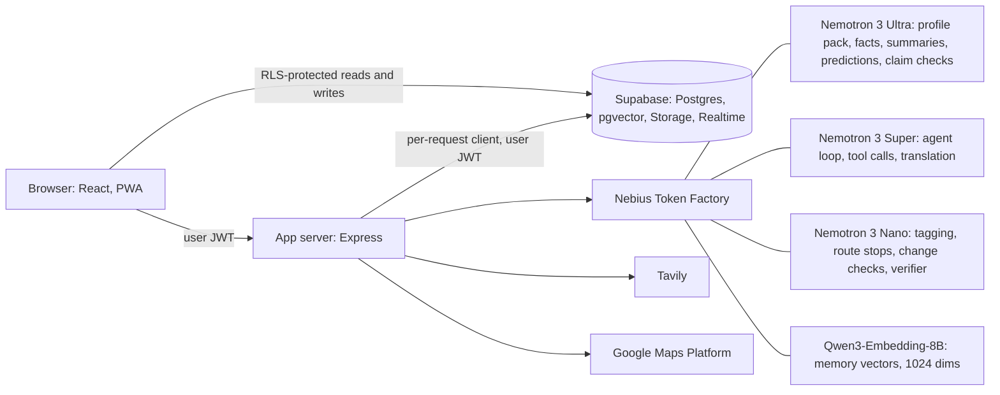

# Finding with Nemo

**An agentic prospecting CRM that works for any business.** Tell it what you sell (or what you are looking for) and a team
of Nemotron models builds your tags, finds prospects on a map, plans your visits, remembers what your salespeople say in
any language, and watches for change. Every fact it states can be traced to a quote, and nothing it proposes changes your
data until you approve it.

Built for the **Nebius x NVIDIA Global AI Hackathon**. Hosted demo, judge login and video are listed in [docs/devpost.md](docs/devpost.md).

> **Existing project declaration.** This started from an earlier prototype, "Client Pipeline & Prospecting CRM": a single-user,
> browser-only map-and-pipeline app hard-coded for welding suppliers in the UAE, with no login and Gemini for AI. The
> state before the hackathon is the git tag [`pre-hackathon`](https://github.com/aaronthomas-ctrl/Finding-with-Nemo/tree/pre-hackathon). Everything below, from the
> multi-tenant database, login, onboarding and roles to the agent, memory, voice, watchers and safety work, was built during the
> hackathon. Compare with `git diff pre-hackathon..main`. The welding, fabricator and UAE assumptions were removed
> (a CI check fails the build if they return); tags, tiers, categories and presets are now data generated per organisation.

## What it does

| | |
| --- | --- |
| **Onboarding** | Business or individual, create or join an org with an invite code. The agent researches your public pages (Tavily) and Ultra drafts a profile pack: tags, tier rules, categories, search areas. You approve it in one card. |
| **Chat agent** | 22 tools: suggest tags, search the map, draw areas, save companies and zones, find nearby saved clients, what is due, tag from websites, log calls, set follow-ups, add leads, plan a route, research a company, check a claim, extract projects, predict the next need, create a watcher. It can drive the screen (draw a polygon, open a route). |
| **Approvals** | Every write is a proposal card you approve, edit or reject. Bulk changes need a second confirmation. Each tool call is audit-logged. |
| **Route planning** | Nano chooses the stops (what is due, what is nearby, priority). Google Directions with `optimize:true` orders them. |
| **Memory and the Evidence Gate** | Facts are stored as vectors. A fact is "verified" only if its quote is found word for word in its source; otherwise it is kept and marked unverified. A verifier pass marks unsupported sentences in replies. |
| **3D memory view** | One dot per memory (UMAP of the embeddings), coloured by type, dim when unverified. Dots the chat just used light up; click one to see its source. |
| **Voice notes** | Record or upload after a meeting, in any language. Transcribed in the speaker's language, translated to English, stored encrypted; facts go through the Evidence Gate and dated next steps become follow-up proposals. Offline notes queue on the device. |
| **Watchers** | Watch a client website, a public LinkedIn or Instagram page (via Tavily only), news, or "upcoming projects in X". Content hashes detect change; Nano filters noise; Ultra summarises; an in-app bell notifies live. |
| **Projects and predictions** | Projects and the companies around them, with suggested links you approve; next-need predictions that combine buying-interval statistics with Ultra's reasoning over project stages. |
| **Safety** | Row level security per organisation, role-based UI, AES-GCM encrypted phone numbers, emails and transcripts, usage caps with a meter, an audit log, and prompt-injection defences measured below. |

## Architecture



The browser only talks to the app server (and to Supabase with the user's own login). The server builds a Supabase client
from each request's JWT, so **row level security applies to every agent action**. The service-role key is never in the
browser or the server container.

### Which model does what

| Role | Model on Token Factory | Used for |
| --- | --- | --- |
| Reasoning | `nvidia/Nemotron-3-Ultra-550b-a55b` | Profile pack, fact extraction with quotes, change summaries, predictions, claim checks, project extraction |
| Agent loop | `nvidia/nemotron-3-super-120b-a12b` (thinking off) | Tool-calling chat, up to 8 steps, streamed; translation of voice notes |
| Fast and parallel | `nvidia/NVIDIA-Nemotron-3-Nano-30B-A3B` | Website tagging, route stop selection, watcher change checks, reply verifier |
| Memory vectors | `Qwen/Qwen3-Embedding-8B` at 1024 dimensions | Multilingual embeddings (this is not a Nemotron model: Token Factory offered no Nemotron embedding model) |
| Speech-to-text | **Not on Token Factory** | Pluggable NVIDIA NIM or any OpenAI-compatible ASR; falls back to the browser's transcript |
| Safety model | **Not on Token Factory** | Not used. Screening is pattern rules plus fencing plus write gates (below) |

## Safety, measured

All numbers are reproducible: `npm run eval:injection`, `npm run eval:agent`. Full reports are in [`docs/`](docs).

**Prompt injection** ([report](docs/injection-results.md), [pages](public/injection-tests/index.html)). Thirteen attack pages, one per attack in the plan
(direct override, fake roles, hidden text, invisible characters, data leak through links, poisoned tool output, fake tool rules,
encoded payloads, spoken commands, spreadsheet formulas, fake authority, memory poisoning, prompts in map data).

| | Result |
| --- | --- |
| Pages flagged by pattern screening | 13 of 13 |
| Trials where no attack effect reached the user (Super as agent) | 70 of 70 |
| Same, with Nano as a weaker agent | 70 of 70 |
| Attacks that succeeded with **every defence switched off** | 3 of 66 (Super), 0 of 66 (Nano) |

Honest reading: the current Nemotron models resist these plain attacks even without help, so the suite shows the attacks are
covered and that nothing got through. It does not show that any single layer is essential. The layers are: hidden-element and
invisible-character stripping, pattern screening (which blocks writes for the rest of a run once triggered), `<untrusted>`
fencing, write tools that only ever create proposals, no rendering of images or links the model writes, a strict
Content-Security-Policy, spreadsheet formula escaping on import and export, and a memory writer that refuses
instruction-shaped text. Small sample (three trials per scenario), fixed attacks, not an adaptive attacker. Building the suite also found and fixed
real bugs in the screening (lost regex escapes, undecoded HTML entities, a pattern that needed a newline that HTML flattening removes).

**Agent evaluation** (30 questions, ten for each of three unrelated synthetic organisations: a cafe supplier, a solar installer, a dental supplier):

<!-- eval:start -->
| Metric | Result |
| --- | --- |
| Questions | 30 across 3 unrelated organisations |
| Overall pass | _not run yet: `EVAL_EMAIL=... EVAL_PASSWORD=... npm run eval:agent` fills this table_ |
<!-- eval:end -->

## Data and compliance

- **Multi-tenant isolation.** Every row carries `org_id`; policies check membership. A user in another org sees nothing, cannot insert into it,
  and cannot make themselves owner. Child rows reference their parent by `(id, org_id)`, so a row can never point at another org's data.
- **Encryption.** Disk and transport are encrypted by Supabase; phone numbers, emails, contacts and voice transcripts are additionally AES-GCM encrypted in
  server code with a key held only as an environment secret.
- **Google Maps terms.** Search results stay in memory and are never written to the database. A saved client stores the `place_id` and the fields the
  user confirms; coordinates come from the Geocoding API (which may be kept) and carry `geo_source`. Any coordinates that came from Places carry a
  `places_fetched_at` date and a daily database cron clears them after 30 days.
- **LinkedIn and Instagram** are reached only through Tavily, public pages only. No scraping and no logins.
- **Demo data is synthetic.** Three invented organisations; no real client data.
- **Notifications are in-app only.** No email, SMS or push.

## Run it

```bash
npm install
cp .env.example .env                 # fill in the keys (see below)
npm run db:apply                     # applies supabase/schema.sql (needs DATABASE_URL and PGSSLROOTCERT, the Supabase CA)
npm run dev                          # http://localhost:3000
npm run seed -- --email you@example.com --activate   # three synthetic orgs, attached to an existing account
```

| Command | What it does |
| --- | --- |
| `npm run lint` | Type check, plus the guard that fails if industry- or country-specific words appear in `src/` or `server/` |
| `npm run test:patterns` | Unit test of the injection screening patterns |
| `npm run eval:injection` | The 13-attack suite with a defences-off control |
| `npm run eval:agent` | The 30-question agent evaluation (needs a seeded account) |
| `npm run build` / `npm start` | Production build and server |
| `docker build` | See [docs/deploy.md](docs/deploy.md) |

### Environment variables

| Variable | Purpose |
| --- | --- |
| `NEBIUS_API_KEY`, `NEBIUS_BASE_URL` | Token Factory (OpenAI-compatible) |
| `MODEL_ULTRA`, `MODEL_SUPER`, `MODEL_NANO`, `MODEL_EMBED`, `EMBED_DIMENSIONS` | Model roles. Names live in config, never in code |
| `SUPABASE_URL`, `VITE_SUPABASE_URL`, `VITE_SUPABASE_ANON_KEY` | Supabase. Only the publishable key reaches the browser |
| `DATABASE_URL`, `PGSSLROOTCERT` | Scripts only (schema, seed). Not needed by the app server |
| `TAVILY_API_KEY` | Web research |
| `GOOGLE_MAPS_PLATFORM_KEY` | Places, Geocoding, Directions (server) and the map (browser build arg, referrer-restricted) |
| `PII_ENCRYPTION_KEY` | 32 random bytes, base64 |
| `ASR_BASE_URL`, `ASR_API_KEY`, `MODEL_ASR` | Optional speech-to-text |

### Layout

```
server.ts            Express app: CSP, per-user auth, routes
server/              llm gateway, auth, usage caps, crypto, tavily, agent loop and tools, memory, voice, watchers, safety
server/prompts/      every prompt, filled from the organisation profile (no industry names in code)
src/                 React app: map, pipeline, chat, memory 3D view, voice, watchers, projects, settings
supabase/schema.sql  42 tables, 140 row level security policies, functions, storage, realtime
scripts/             seed, evaluations, schema applier, icon and test-page generators
public/injection-tests/   the 13 attack pages
docs/                evaluation reports, deploy guide, demo script, Devpost draft
```

## Known limits

- **Speech-to-text** is not on Token Factory. Until an NVIDIA NIM key is configured, the browser's speech recognition supplies the transcript (Chrome works best, and it may send audio to the browser vendor). Translation of Malayalam and Urdu was less reliable in testing and is flagged in the UI; the original is always kept.
- **No Nemotron safety model or embedding model** was available on Token Factory (see the table above).
- **Scheduled watchers** are not built: watchers run with "Run now". The 30-day coordinate cleanup and retry flags run in the database.
- **Evidence Gate scope.** It proves a quote exists in the source text, not that the source is true. For translated voice notes the quote is checked against the translation.
- **Project links** match companies to clients by name only (exact or contains).
- Contacts are stored as one encrypted blob per client, not in the `contacts` table.
- The service worker and the signed-in mobile screens were not checked in a real browser; the Docker image has not been built on the authoring machine (see [docs/deploy.md](docs/deploy.md)).
- The Tier 1 watch screens, warehouse stock browser and direct-push ledger from the original prototype were removed; an outreach log and lean campaigns replace them.

Licence: Apache-2.0.
